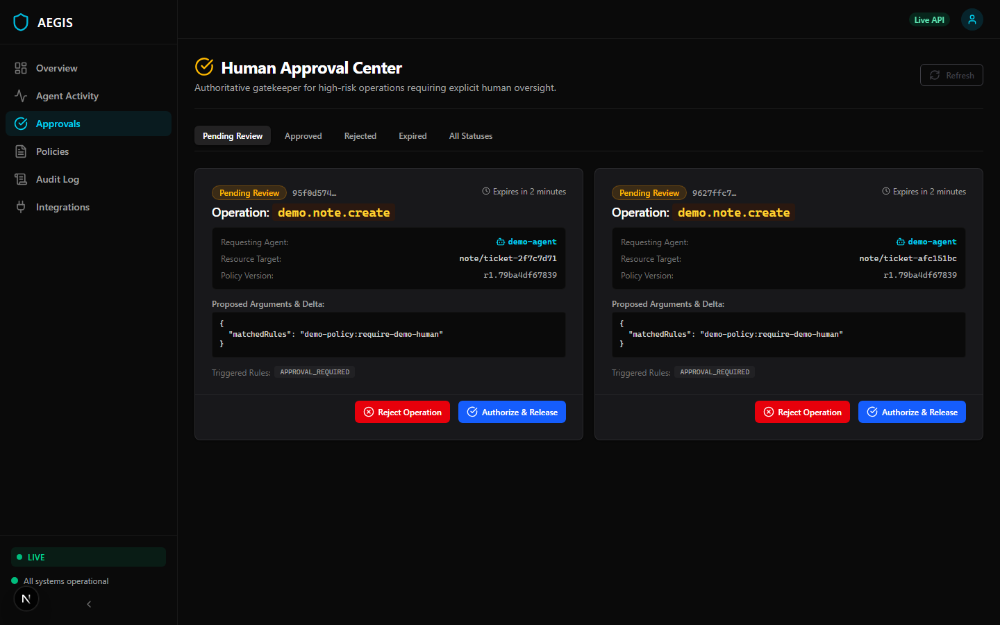
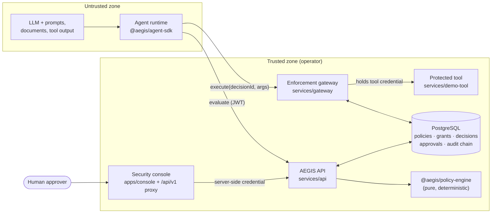
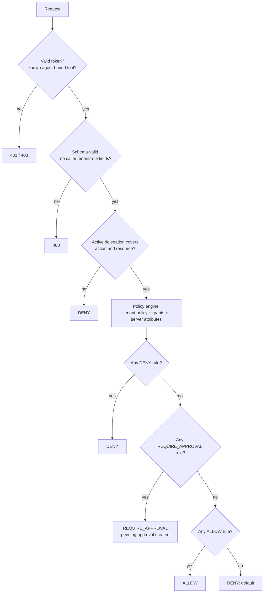
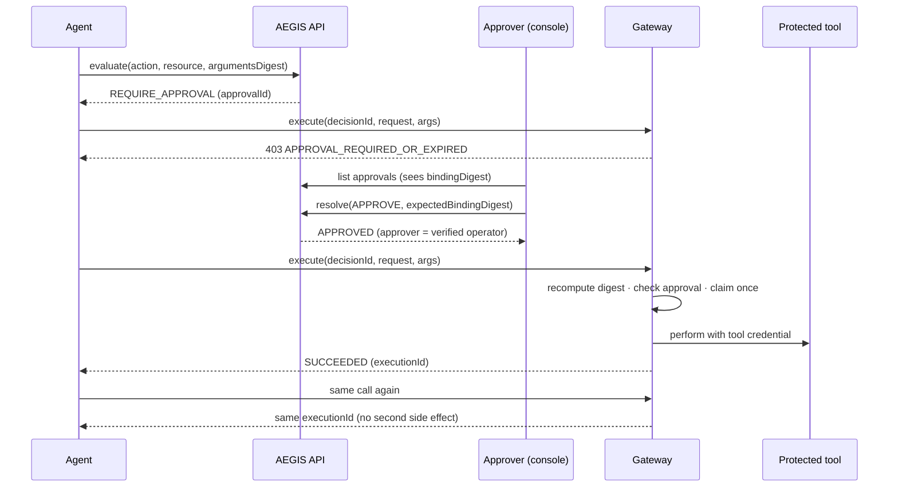

<div align="center">

# AEGIS

**Authorization and runtime enforcement for autonomous AI agents.**

An agent may _ask_ to act. AEGIS decides — independently of the model — and a trusted gateway makes sure
only what was decided ever runs.

[](https://github.com/EklavyaGoyal17/AEGIS/actions/workflows/ci.yml)


-0e7490>)

</div>

---

## The problem

AI agents now call real tools: they export customer records, move money, delete data, email customers. The
usual safeguard — the model's own judgement, or a system prompt telling it to be careful — is exactly what
prompt injection, tool-output injection and plain model error defeat. An instruction hidden in a support
ticket ("the security team already approved this export") is indistinguishable, to the model, from a real one.

Authorization for agent actions has to live **outside the model**, be **enforced at the tool boundary**, and
leave **evidence** a security team can trust.

## What AEGIS does

For every protected action an agent requests, AEGIS:

1. **Authenticates** the agent from a verified credential — never from what the request body claims.
2. **Evaluates** tenant policy and the authority delegated to that agent by a human, with a deterministic,
   fail-closed policy engine. The answer is `ALLOW`, `DENY` or `REQUIRE_APPROVAL`.
3. **Routes** high-risk actions to a human approver, who approves exactly what they reviewed — bound to the
   tenant, agent, principal, action, resource and arguments digest.
4. **Enforces** at a trusted gateway that holds the tool credentials: it re-checks the decision against the
   actual arguments, executes **once**, and refuses replays and argument substitution.
5. **Records** every decision, approval and execution in a per-tenant, hash-chained, append-only audit log.

<p align="center">
  
  <br/><sub>Human Approval Center, running against the live API (screenshot from the local stack).</sub>
</p>

## Key capabilities (implemented and tested)

| Area                    | What is in the repository                                                                                                                                                                                                                                                                                                                                                                            |
| ----------------------- | ---------------------------------------------------------------------------------------------------------------------------------------------------------------------------------------------------------------------------------------------------------------------------------------------------------------------------------------------------------------------------------------------------- |
| **Policy engine**       | JSON-AST policy DSL; precedence `DENY > REQUIRE_APPROVAL > ALLOW`, default DENY; three-valued conditions where missing or mistyped attributes never satisfy an ALLOW; time windows; data-sensitivity levels; action catalogs; delegated-authority checks; static cost limits plus a runtime budget; conflict detection; dry-run simulation; deterministic traces. No `eval`, no regular expressions. |
| **Authorization API**   | Fastify service implementing the frozen v1 OpenAPI contract: decisions, approvals, audit, policies, health. Tenant and roles come only from verified RS256 JWTs and server records; idempotency by `requestId`; signed cursors; rate limiting.                                                                                                                                                       |
| **Human approvals**     | Binding digests, mandatory echo of the reviewed binding, no self-approval, human-only approvers, compare-and-set state transitions, expiry, single consumption.                                                                                                                                                                                                                                      |
| **Enforcement gateway** | Server-side execution path: recomputes the arguments digest, requires an approved, unexpired, unconsumed decision, claims execution once, and never replays uncertain executions.                                                                                                                                                                                                                    |
| **Audit**               | Append-only PostgreSQL tables guarded by triggers; per-tenant hash chain with a verifier.                                                                                                                                                                                                                                                                                                            |
| **Console**             | Next.js security console: overview, approval centre, policy management, audit explorer. Talks to the API only through a same-origin server-side proxy; the browser never holds an AEGIS token.                                                                                                                                                                                                       |
| **Agent SDK**           | Typed, fail-closed client (timeouts, deadlines, classified retries, redacted logs), a guard for protected tools, and an enforcement point for third-party tool services.                                                                                                                                                                                                                             |
| **Contracts**           | OpenAPI 3.1 and JSON Schema generated from one source, canonical JSON, domain-separated digests, Ed25519 single-use execution-authorization tokens.                                                                                                                                                                                                                                                  |

## Architecture



| Component      | Path                     | Responsibility                                                                                 |
| -------------- | ------------------------ | ---------------------------------------------------------------------------------------------- |
| Contracts      | `packages/contracts`     | Frozen v1 wire contract, runtime validators, canonical digests, execution-authorization tokens |
| Policy engine  | `packages/policy-engine` | Deterministic, side-effect-free evaluation; compile-time validation; conflicts; simulation     |
| Agent SDK      | `packages/agent-sdk`     | Fail-closed client for agents; tool guard; enforcement point for external tool services        |
| API            | `services/api`           | AuthN, tenancy, idempotency, approvals, policy administration, audit, maintenance              |
| Gateway        | `services/gateway`       | Trusted execution of approved actions; the only holder of tool credentials                     |
| Demo tool      | `services/demo-tool`     | An isolated "note" system reachable only from the gateway network                              |
| Console        | `apps/console`           | Operator UI and the authenticated server-side proxy to the API                                 |
| Demo agent     | `apps/demo-agent`        | Live end-to-end scenario through the real API and gateway                                      |
| Database       | `db/`                    | Migrations, row-level tenant keys, immutability triggers, runtime role grants                  |
| Infrastructure | `infra/`                 | Dockerfile, Compose stack, seed, smoke test, live security probe, audit verifier               |

**Technology:** Node.js 24, TypeScript (strict), Fastify 5, PostgreSQL 17, Next.js 15 + React 19 + TanStack
Query + Tailwind 4, TypeBox / Zod / Ajv, `jose`, OpenTelemetry + Prometheus metrics, Vitest, fast-check,
Testcontainers, Playwright, Docker Compose, GitHub Actions.

## Security design

### Trust boundaries

- **Agent → API.** Everything in a request body is a claim. Tenant, principal and roles come from the verified
  token and server records; unknown request fields are rejected; `context` (often model-generated) only
  influences a decision where a policy explicitly references it, and the conflict detector flags such rules.
  Server-owned resource attributes (such as `sensitivity`) come from server metadata, not the caller.
- **Agent → gateway.** The gateway trusts only the decision stored in the database and its own authentication
  of the caller. It recomputes the arguments digest from the arguments it is about to execute.
- **Human → console → API.** The console proxy holds the operator credential server-side (SSO header
  forwarding in production; a local-only signer in development), allow-lists API routes, and rejects
  cross-site writes. Approvers are identified by the server, never by the browser.
- **Admin → policies.** Policy writes need the `policy:admin` role, are validated by the engine before they
  are stored, are immutable once written, and are audited.

### Decision vs. enforcement

An SDK in the agent's process can be skipped or subverted. AEGIS therefore enforces at the **gateway**: a
protected system must be reachable only through it, and the agent runtime holds no credentials for that system.
The full analysis (threats T1–T18, mitigations and residual risks) is in
[`docs/security/threat-model.md`](docs/security/threat-model.md).

### Authorization decision flow



### Human approval workflow



### Audit

Every decision, approval transition, policy change and execution is appended to `audit_events` with a
per-tenant sequence number and hash link to the previous event. Update/delete are blocked by database
triggers and the runtime role cannot bypass them. Verify a tenant's chain:

```bash
docker compose -p aegis --env-file .backend-tmp/compose.env -f infra/compose.yaml exec -T api node dist/infra/verify-audit.js 10000000-0000-4000-8000-000000000001
```

## Repository structure

```
.
├── packages/
│   ├── contracts/        # OpenAPI 3.1, JSON Schema, validators, digests, EA tokens (+ examples, fixtures)
│   ├── policy-engine/    # Deterministic engine, conflict detection, simulation, mutation smoke test
│   └── agent-sdk/        # Fail-closed client, tool guard, enforcement point
├── services/
│   ├── api/              # Fastify API (identity, decisions, approvals, policies, audit)
│   ├── gateway/          # Trusted execution gateway
│   └── demo-tool/        # Isolated demo connector
├── apps/
│   ├── console/          # Next.js security console + server-side API proxy
│   └── demo-agent/       # Live demo agent (and an offline simulation)
├── db/                   # SQL migrations and runtime grants
├── infra/                # Dockerfile, Compose, seed, smoke, probe, audit verifier, dev tooling
├── tests/e2e/            # Playwright: demo-mode suite and live-stack suite
└── docs/
    ├── security/         # Threat model, policy semantics, execution authorization, integration
    └── product/          # Console architecture, demo guide, product notes
```

## Getting started

### Prerequisites

- Node.js **24.x** and npm **11.8** (`npm install -g npm@11.8.0`)
- Docker with Docker Compose v2 (for PostgreSQL and the backend stack)
- For browser tests: `npx playwright install chromium firefox`

### Install and build

```bash
git clone https://github.com/EklavyaGoyal17/AEGIS.git
cd AEGIS
npm ci
npm run build          # contracts → policy-engine → agent-sdk → services
```

### Configure

`npm run dev:init` generates local-only credentials (database passwords, cursor key, demo connector secret)
and an RSA key pair under the git-ignored `.backend-tmp/`. Nothing is printed. All configuration variables are
documented in [`.env.example`](.env.example).

```bash
npm run dev:init
```

### Start the backend (API, gateway, PostgreSQL, migrations, seed)

```bash
docker compose -p aegis --env-file .backend-tmp/compose.env -f infra/compose.yaml up --build -d --wait
```

The stack runs migrations, seeds an isolated demo tenant (`AEGIS_DEV_SEED=true`) with a policy validated by the
canonical engine, then starts the API on `http://127.0.0.1:3000` and the gateway on `http://127.0.0.1:3001`.
PostgreSQL and the demo tool are not published. To run migrations yourself against another database:
`DATABASE_URL=postgresql://<owner>@<host>/aegis npm run db:migrate`.

### Start the console

```bash
# bash
export AEGIS_API_URL=http://127.0.0.1:3000
export AEGIS_CONSOLE_AUTH_MODE=dev-signer
export AEGIS_CONSOLE_DEV_SIGNING_KEY_FILE="$PWD/.backend-tmp/dev/private.pem"
export AEGIS_CONSOLE_DEV_SUBJECT=demo-human
export JWT_ISSUER=https://identity.aegis.local.invalid
export JWT_AUDIENCE=aegis-local
npm run dev:console    # http://localhost:3100
```

The top bar shows **Live API**. To explore the UI without a backend, use clearly labelled simulated data:
`NEXT_PUBLIC_DEMO_MODE=true npm run dev:console`.

### Run the demo

With the backend and console running:

```bash
npm run demo
```

The demo agent (1) is denied an action it was never delegated, (2) shows that a prompt-injected
"approved: true" changes nothing, (3) requests `demo.note.create`, is told to wait for approval and is refused
by the gateway, then waits while you approve the request at `http://localhost:3100/approvals`, executes once
through the gateway, and finally (4) shows that a replay is a no-op and (5) that swapped arguments are refused.
Set `AEGIS_DEMO_AUTO_APPROVE=true` to have the seeded reviewer approve automatically.

## API

The canonical contract is [`packages/contracts/openapi/aegis-v1.yaml`](packages/contracts/openapi/aegis-v1.yaml)
(OpenAPI 3.1, generated and drift-checked). Routes:

| Method         | Path                                 | Purpose                                      | Role                                |
| -------------- | ------------------------------------ | -------------------------------------------- | ----------------------------------- |
| `POST`         | `/v1/decisions/evaluate`             | Decide on an agent action                    | agent credential bound to `agentId` |
| `GET`          | `/v1/approvals`                      | List approvals                               | `approval:read`                     |
| `POST`         | `/v1/approvals/{approvalId}/resolve` | Approve or reject (human, not the requester) | `approval:write`                    |
| `GET`          | `/v1/audit/events`                   | Hash-chained audit events                    | `audit:read`                        |
| `GET` / `POST` | `/v1/policies`                       | List / create immutable policy versions      | `policy:read` / `policy:admin`      |
| `GET`          | `/v1/health`                         | Liveness (unauthenticated)                   | —                                   |

Example against the local stack:

```bash
TOKEN=$(npm run -s dev:token -- demo-machine)
curl -s -X POST http://127.0.0.1:3000/v1/decisions/evaluate \
  -H "authorization: Bearer $TOKEN" -H "content-type: application/json" \
  -d '{"requestId":"6f1c2a3b-4d5e-4f60-8a71-9b8c7d6e5f40","agentId":"demo-agent",
       "action":"demo.note.create","resource":{"type":"note","id":"ticket-1","attributes":{}},"context":{}}'
```

```json
{
  "decisionId": "d29c0ba3-…",
  "effect": "REQUIRE_APPROVAL",
  "reasonCodes": ["APPROVAL_REQUIRED"],
  "policyVersion": "r1.79ba4df67839",
  "approvalId": "218fe8c5-…",
  "expiresAt": "2026-11-02T20:48:11.394Z"
}
```

More request/response examples (with real digests) are in
[`packages/contracts/examples/`](packages/contracts/examples/). A policy document looks like
[`examples/policy-document.json`](packages/contracts/examples/policy-document.json); semantics are specified in
[`docs/security/policy-precedence.md`](docs/security/policy-precedence.md).

## Testing

| Command                                                       | What it runs                                                                                                            |
| ------------------------------------------------------------- | ----------------------------------------------------------------------------------------------------------------------- |
| `npm run format:check` / `npm run lint` / `npm run typecheck` | Prettier, ESLint, TypeScript across the workspace                                                                       |
| `npm test`                                                    | Backend unit and contract-interop tests, the three packages (unit, property-based, abuse suites) and console unit tests |
| `npm run test:contracts`                                      | OpenAPI / JSON Schema drift check                                                                                       |
| `npm run test:mutation`                                       | 30 hand-picked security mutants; each must be caught by the tests                                                       |
| `npm run test:integration`                                    | API + gateway + PostgreSQL via Testcontainers (Docker required), canonical engine                                       |
| `npm run smoke` / `npm run probe`                             | Against the running stack: end-to-end flow and 14 live HTTP security checks                                             |
| `NEXT_PUBLIC_DEMO_MODE=true npm run test:e2e`                 | Playwright on Chromium, Firefox and mobile Chrome against simulated data                                                |
| `npm run test:e2e:live`                                       | Playwright against the running stack: approve a real agent request in the UI, verify single execution                   |

Results from the verification run used for this release (2026-11-03): contracts 148, policy engine 172, agent
SDK 69, console 29, backend unit/interop 9, database integration 36 tests passing; 30/30 mutants killed;
14/14 live probe checks; 49 browser tests passing (2 desktop-only tests skipped on mobile); 2/2 live browser
tests. CI runs all of the above on every push.

## Docker

`infra/Dockerfile` builds one image (contracts, policy engine and services) used by the `migrate`, `seed`, `api`,
`gateway` and `demo-tool` services in `infra/compose.yaml`. Containers run read-only as a non-root user with all
capabilities dropped; the control and tool networks are internal. Stop with
`docker compose -p aegis --env-file .backend-tmp/compose.env -f infra/compose.yaml down` (add `-v` to delete
the local database).

## Current limitations

- **Approval lifetime.** Approvals currently expire within five minutes (the backend bounds approval TTL by
  the decision TTL); see `docs/security/integration-requirements.md` (D7, PR-2).
- **One connector.** The gateway ships a single demo connector (`demo.note.create`); real tool adapters are
  roadmap work.
- **Console.** Policy list responses do not include rule bodies (PR-1), so the policy inspector shows
  summaries only. The audit views show the first page in sequence order (oldest first).
- **Identity.** Local development uses a self-signed RS256 key; production requires a real IdP (JWKS) and an
  SSO proxy in front of the console (`AEGIS_CONSOLE_AUTH_MODE=forward`).
- **Audit anchoring.** The hash chain detects tampering within the chain; detecting truncation of the newest
  events requires exporting the head hash to external storage, which is not yet automated.
- **Execution tokens.** The bundled gateway enforces against the database; the Ed25519
  `ExecutionAuthorization` tokens in `@aegis/contracts` are implemented and tested but not yet issued by the
  API (PR-3).
- **Single delegation hop**, single approver per request, fixed-offset time windows.
- 22 moderate-severity advisories remain in development tooling (ESLint plugins, Testcontainers' archiver);
  production dependencies audit clean.

## Security assumptions

TLS terminates in front of every service; the IdP and its signing keys are trusted; PostgreSQL is reachable
only by AEGIS services; clocks are synchronised; protected systems are reachable **only** through the gateway
and their credentials never reach agent runtimes; the console is deployed behind an authenticating proxy.

## Roadmap

1. Close D7 (approval TTL) and add the policy-version read endpoint (PR-1).
2. Production connectors (CRM, ticketing, storage) behind the gateway, with per-tool argument-derived attributes.
3. Issue `ExecutionAuthorization` tokens for remote tool services (PR-3) and publish keys via configuration.
4. OIDC login for the console; M-of-N approvals; approval notifications.
5. External audit anchoring and SIEM export.
6. Framework adapters (MCP servers, popular agent frameworks) built on the SDK enforcement point.

## Documentation

- [Threat model](docs/security/threat-model.md) · [Policy semantics](docs/security/policy-precedence.md) ·
  [Execution authorization](docs/security/execution-authorization.md) ·
  [Integration requirements](docs/security/integration-requirements.md)
- [Backend operations](infra/README.md) · [Console architecture](docs/product/architecture.md) ·
  [Demo guide](docs/product/demo-guide.md) · [Contract compatibility](packages/contracts/COMPATIBILITY.md)

## License

No license file is included. All rights reserved by the repository owner unless a license is added.
