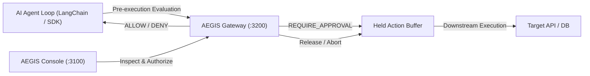

# AEGIS Console Architecture & Product Engineering Specification

This document details the design system, state machine, threat model, and technical architecture of the AEGIS Security Operations Console.

---

## 1. System Overview

AEGIS is an enterprise security and human-in-the-loop governance console for autonomous AI agents. Unlike conversational AI interfaces, AEGIS is structured as an infrastructure control plane comparable to enterprise SIEM and identity governance systems.

---

## 2. Technical Stack

- **Runtime & Framework**: React 19, Next.js 15 (App Router, Standalone build output)
- **Language**: TypeScript Strict Mode (`noImplicitOverride`, `exactOptionalPropertyTypes: false`, `noUncheckedIndexedAccess`)
- **Styling**: Tailwind CSS v4 with bespoke dark-mode security operations color palette
- **Data Fetching & Caching**: TanStack Query v5 with optimistic concurrency mutation handling
- **Schema Validation**: Zod runtime schema decoding for all HTTP responses
- **Component Primitives**: Accessible headless primitives with full ARIA semantics and keyboard navigability
- **Test Harness**: Vitest (component & unit), Playwright (multi-browser E2E)

---

## 3. Product Modules

### A. Shell & Design System (`src/components/layout/**`, `src/components/ui/**`)
- **Visual Identity**: Tailored dark-mode palette (`surface-0` to `surface-950`) optimized for low-fatigue operations centers.
- **Environment Indicator**: Unmistakable top banner and sidebar badges contrasting `DEMO MODE` (amber) with `LIVE` (emerald).
- **Accessibility**: Standard ARIA landmarks (`aside`, `header`, `main`, `dialog`), focus-visible rings, keyboard escape traps on modals, and screen-reader status hints.

### B. Security Operations Overview (`src/app/(dashboard)/page.tsx`)
- Surfaces key authorization metrics derived from live audit streams.
- Prioritizes pending approval cards with quick action buttons.
- Summarizes blocked actions and active security rules.

### C. Agent Activity Explorer (`src/app/(dashboard)/activity/page.tsx`)
- High-density queryable table of agent tool invocations.
- Instant client-side and server-side filtering by Agent ID, Outcome (`ALLOW`, `DENY`, `REQUIRE_APPROVAL`), and Correlation ID.
- Expandable investigation drawer with automatic redaction of sensitive credentials and PII.

### D. Human Approval Center (`src/app/(dashboard)/approvals/page.tsx`)
- Authoritative human-in-the-loop review station.
- Shows proposed arguments, target resource, expiration countdown, and policy reasoning codes.
- Two-step confirmation dialog with mandatory reviewer justification note.
- Fail-safe state machine: Prevents approving expired or consumed approvals.

### E. Policy Management (`src/app/(dashboard)/policies/page.tsx`)
- Declarative rule catalog with human-readable condition breakdowns.
- Structured modal policy builder with strict schema validation.
- Fail-closed guardrail warnings preventing accidental policy escalation.

### F. Audit Investigation & Evidence Trail (`src/app/(dashboard)/audit/page.tsx`)
- Chronological event timeline with deep correlation thread lookup.
- Raw JSON evidence inspector.
- Clear distinction between system-logged records and cryptographically verified evidence.

### G. Integrations & Agent SDK (`src/app/(dashboard)/integrations/page.tsx`)
- Reference code patterns for integrating `@aegis/agent-sdk`.
- Status indicators for Local Gateway and MCP Connector concepts.

---

## 4. Threat Model & Security Posture

1. **Authoritative Backend**: The UI is strictly an operator interface. It **never** evaluates policies locally to permit actions. The Policy Engine and Gateway are the sole source of truth.
2. **Zero Client Secret Storage**: Long-lived service API keys and database credentials are never stored in localStorage, sessionStorage, or client-side bundles.
3. **Sensitive Data Redaction**: The console automatically masks tokens, keys, and customer PII before rendering raw argument payloads in activity drawers.
4. **Optimistic Conflict Defense**: When an approval is resolved, the mutation is committed against the server before UI state transitions to resolved, preventing duplicate release bugs.
